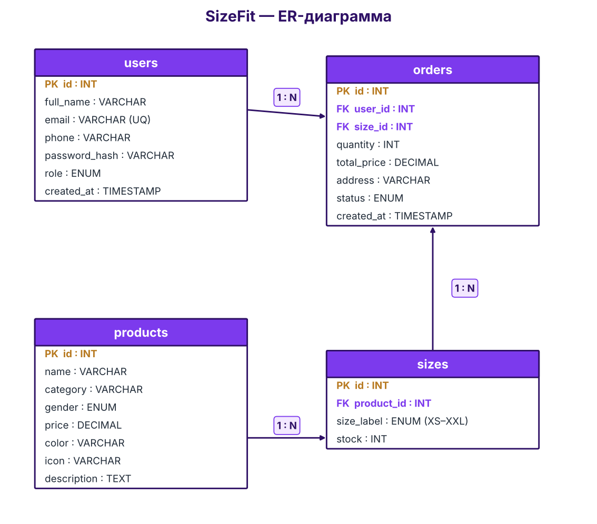

# SizeFit — Онлайн киім өлшемін таңдау және тапсырыс беру жүйесі

PHP және MySQL қолданып әзірленетін жеке оқу жобасы.

## 1. Жоба туралы

SizeFit — сатып алушыға өз өлшемін дұрыс анықтап, киімге онлайн тапсырыс беруге көмектесетін веб-қосымша. Пайдаланушы кеуде, бел өлшемі мен бойын енгізеді, жүйе оған сай өлшемді (XS–XXL) ұсынады. Сосын каталогтан сол өлшемде қоймада бар киімдерді сүзіп, тапсырыс береді.

**Жобаның мақсаты** — онлайн киім сатып алғанда өлшемді қате таңдау мен тауарды қайтару жағдайларын азайту.

## 2. Негізгі мүмкіндіктер

- **Өлшем кеңесшісі:** кеуде және бел айналымы бойынша ыңғайлы өлшемді анықтау, өлшемдер кестесі.
- **Каталог:** киімдер тізімі, әр өлшемнің қоймадағы саны.
- **Іздеу және сүзгілеу:** атауы, санаты және қоймада бар өлшемі бойынша.
- **Тапсырыс беру:** өлшем, сан және жеткізу мекенжайын көрсетіп тапсырыс жасау.
- **Тіркелу және авторизация:** пайдаланушы аккаунт құрып, жүйеге кіреді.
- **Жеке кабинет:** тапсырыстар тізімі мен мәртебесі (жаңа / расталды / жолда / жеткізілді / бас тартылды), жаңа тапсырыстан бас тарту.
- **Әкімші панелі:** тауарлар мен тапсырыстарды басқару.
- **Деректерді қорғау:** енгізілген ақпаратты тексеру және құпиясөзді хэштеп сақтау.

## 3. Технологиялар

- **Frontend:** HTML5, CSS3, JavaScript
- **Backend:** PHP
- **Database:** MySQL (PDO арқылы қосылу)
- **Жергілікті сервер:** XAMPP
- **Нұсқаларды басқару:** Git және GitHub

## 4. Беттер тізімі

1. `index.php` — басты бет
2. `catalog.php` — киімдер каталогы, іздеу/сүзгі және тапсырыс формасы
3. `size.php` — өлшемді анықтау (өлшем кеңесшісі) және өлшемдер кестесі
4. `register.php` — тіркелу
5. `login.php` — жүйеге кіру
6. `profile.php` — жеке кабинет және «Менің тапсырыстарым»
7. `logout.php` — жүйеден шығу
8. `admin.php` — әкімші панелі (келесі кезеңде)

## 5. Дерекқор құрылымы (MySQL — 4 кесте)

- **users** — пайдаланушылар: аты-жөні, email, телефон, құпиясөз хэші, рөлі (customer / admin).
- **products** — тауарлар: атауы, санаты, кімге арналғаны, бағасы, сипаттамасы.
- **sizes** — әр тауардың өлшемдері (XS–XXL) және қоймадағы саны.
- **orders** — тапсырыстар: кім, қай тауардың қай өлшемі, саны, сомасы, мекенжайы, мәртебесі.

## 6. ER-диаграмма

**Кестелер арасындағы байланыстар:**

- **products → sizes (1:N):** бір тауардың бірнеше өлшемі болады.
- **users → orders (1:N):** бір пайдаланушы бірнеше тапсырыс бере алады.
- **sizes → orders (1:N):** бір өлшемге бірнеше тапсырыс түсуі мүмкін.

**PK** — негізгі кілт, **FK** — сыртқы кілт, **UQ** — қайталанбайтын мән.

## 7. Қауіпсіздік

- Құпиясөздер `password_hash()` арқылы хэштеліп сақталады, `password_verify()` арқылы тексеріледі.
- SQL сұраныстары PDO арқылы параметрленген түрде (prepared statements) орындалады — SQL-инъекциядан қорғау.
- Пайдаланушы енгізген деректер серверде тексеріледі (email, телефон, өлшемдер, тауар саны).
- Экранға шығатын мәтін `htmlspecialchars()` арқылы өңделеді — XSS шабуылынан қорғау.
- Тапсырыс пен жеке кабинет тек жүйеге кірген пайдаланушыға қолжетімді.
- Тапсырыс беру мен қойманы азайту транзакция ішінде орындалады.

## 8. Апта бойынша орындалған жұмыс

- [x] **8-апта:** жоба жоспары, беттер тізімі, дерекқор құрылымы, ER-диаграмма және README.
- [ ] **9-апта:** 3 адаптивті статикалық бет.
- [ ] **10-апта:** `include`, `$_GET` және `$_POST` өңдеу.
- [ ] **11-апта:** дерекқор, PDO, аутентификация, сессиялар.
- [ ] **Келесі кезең:** әкімші панелі — тауарларды қосу/өңдеу/жою (CRUD) және тапсырыс мәртебесін өзгерту.

## 9. Жобаны іске қосу

1. XAMPP бағдарламасын ашып, **Apache** серверін іске қосу.
2. Жоба бумасын `C:\xampp\htdocs\sizefit` мекенжайында сақтау.
3. Браузерде `http://localhost/sizefit/` мекенжайын ашу.
4. Дерекқорды пайдаланатын функциялар (11-апта) қосылғаннан кейін MySQL қызметін іске қосып, `database.sql` файлын импорттау.
